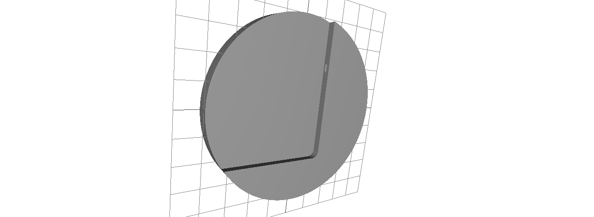

# iPad-Wandhalterung

Runde Wandhalterung für das iPad als Home-Assistant-Wanddisplay, nachgebaut nach dem Vorbild der Displine-Halterung.

## Dateien

| Datei | Inhalt |
| --- | --- |
| `Ipad_Halterung_Displine_Nachbau.FCStd` | FreeCAD-Quelldatei zum Weiterbearbeiten |
| `Ipad_Wandhalterung_v1.stl` | Druckfertiges Modell (Version 1) |
| `Ipad_Wandhalterung_v1.png` | Vorschaubild |

## Maße (aus der STL)

- Durchmesser: ca. 170 mm
- Tiefe: ca. 22 mm
